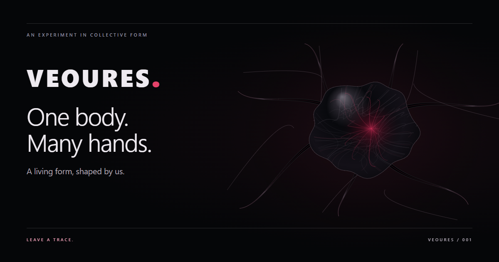

# VEOURES

**One body. Many hands.**

A living digital organism shaped by human traces. Draw a scar, plant a letter, offer a word, grow a limb, feed mass, heal or disturb its tissue. Every accepted change becomes anatomy. Visitors decide what it means.

[Enter the shared organism](https://veoures.softaspen8.chatgpt.site/) · [Local fallback](https://thelouismahdi.github.io/veoures/?mode=local) · [Run a shared organism](#run-a-shared-organism) · [Brand guide](docs/BRAND.md) · [Architecture](docs/ARCHITECTURE.md)



The public site is live and shared: every visitor shapes the same persistent organism. Open the link, preview a change, then commit it. No account or installation is required. The footer says **SHARED ONLINE**. [Privacy and contribution limits](https://veoures.softaspen8.chatgpt.site/privacy.html) explain the anonymous session and abuse limits.

## What lives here

- Procedural Canvas 2D anatomy, with breathing, tapered limbs, glossy tissue, growth and healing.
- Seven mutation tools with visible previews, cancellation and an explicit commit. Previews spend no quota; accepted commits are limited to five per browser per UTC day.
- Pointer, touch and keyboard positioning; native dialogs, visible focus, high-contrast support and reduced motion.
- Optional original ambient audio and tool feedback. Sound starts off; no audio is requested before opt-in.
- Persistent local history or an ordered shared event log, with idempotent commits and connection recovery.

Vanilla HTML, CSS and JavaScript. No framework, application build step or runtime npm dependencies.

## Try it locally

Clone this repository and enter its directory:

```sh
git clone https://github.com/TheLouisMahdi/veoures.git
cd veoures
python -m http.server 8002 --bind 127.0.0.1
```

Open [localhost:8002](http://localhost:8002/). The footer says **LOCAL DEMO - Only this browser remembers.** Local changes stay on that browser origin. Use HTTP rather than opening `index.html` as a file.

## Run a shared organism locally

Requires Node 18 or newer. No package installation is needed. From the repository root, use PowerShell:

```powershell
$env:PUBLIC_DIR = (Get-Location).Path
$env:VEOURES_DATA_FILE = Join-Path (Split-Path $env:PUBLIC_DIR -Parent) '.veoures-data/organism-data.json'
$env:PORT = '8000'
node server/server.js
```

Or macOS / Linux:

```sh
PUBLIC_DIR="$PWD" VEOURES_DATA_FILE="$(dirname "$PWD")/.veoures-data/organism-data.json" PORT=8000 node server/server.js
```

Open [localhost:8000](http://localhost:8000/) in two browsers or profiles. **SHARED ONLINE** indicates real shared persistence. Other visible clients receive accepted changes within the five-second polling interval. Reload and server restart replay the same body.

Keep `VEOURES_DATA_FILE` outside the public directory, on persistent disk. The server creates it on the first accepted change and refuses an internal path. Do not run multiple writers against the same file. Browser tokens provide a demo quota boundary, not account authentication; see [operational limitations](docs/ARCHITECTURE.md#limits-of-this-shared-demo).

## Interact

Choose a tool and a point, preview, then **Commit change**. Cancel or Escape discards the preview. On mobile, collapse the controls to see the body and swipe the tool rail to reach all seven tools. For keyboard positioning, focus the canvas, use arrows, then Enter; sliders are also available under **Position & keyboard controls**. Inspector shows current status and the latest 30 traces.

Letters and words morph tissue rather than appearing as graffiti. Sound is off on every visit and stops when disabled or the tab becomes hidden.

## Publish

[GitHub Actions](.github/workflows/pages.yml) runs dependency-free checks and deploys an explicit static allowlist to GitHub Pages. `node scripts/build-static.cjs` creates that same artifact in `_site/`; it includes the browser app and original media, while excluding server code, tests, documentation and private runtime data.

**GitHub Pages keeps a local fallback.** Its default URL forwards to the public shared site; append `?mode=local` to use browser-only storage. The public edition runs a dependency-free Worker with a durable D1 database, using the same vanilla frontend and authoritative reducer. [Hosting source and checks](hosting/README.md) are included. The original Node/JSON server remains available for local development. A shared origin never silently switches to local persistence after a network failure.

## Verify and explore

```sh
node tests/reducer-check.cjs
node tests/server-smoke.cjs
node scripts/build-static.cjs
node tests/publication-check.cjs
# Node 24: public persistence adapter
node hosting/build.mjs
node hosting/tests.mjs
```

Browser tests can use an existing Playwright installation: set `PLAYWRIGHT_MODULE`, `CHROME_PATH`, `STATIC_URL`, `SHARED_URL` and optionally `QA_OUTPUT`, then run `node tests/browser-check.cjs`. Start both servers first and use disposable shared data; the test commits real mutations. `tests/asset-check.cjs` verifies running asset URLs, including optional `SUBPATH_URL`.

- [Verification results and inspected screenshots](docs/VERIFICATION.md)
- [Public launch and verification](docs/PUBLIC_LAUNCH.md)
- [Architecture and limitations](docs/ARCHITECTURE.md)
- [Brand identity](docs/BRAND.md)
- [Integration file inventory](docs/CHANGED_FILES.md)
- [Publication changes](docs/PUBLICATION.md)
- [Credits, provenance and rights](docs/CREDITS.md)

A project by [TheLouisMahdi](https://github.com/TheLouisMahdi). Supplied original media retains its provenance; no blanket open-source license is asserted for the code or assets.
